# 調度員操作手冊

這份手冊說明每天的派車流程：**建立訂單 → 拖單排班 → 檢查規則 → 發布 → 列印派車單**。

畫面中的司機 A～D、車 1～4 是佔位資料，上線後會改成真實姓名與車牌。

---

## 1. 登入

打開系統網址，按「使用 Google 帳號登入」，選你的 Google 帳號。

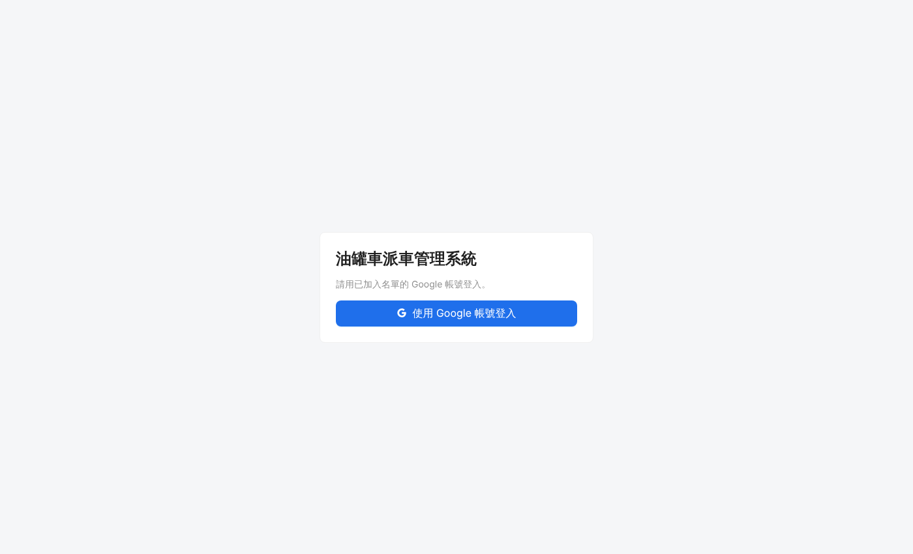

- 只有「登入名單」上的帳號能登入。進不去時，請已經能登入的同事到「設定 → 使用者」把你加入（見第 9 節）。
- 測試期間第一次登入，Google 可能顯示「Google 尚未驗證這個應用程式」，按「繼續」即可。
- 登入 12 小時後要重新登入。
- 用完公用電腦請按右上角的「登出」。

---

## 2. 建立訂單

油站叫油時，到「訂單管理」按「新增訂單」。

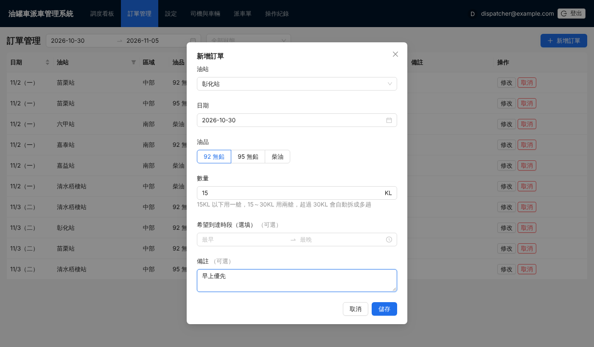

| 欄位 | 說明 |
|---|---|
| 油站 | 依中部、南部分組 |
| 日期 | 要送油的日期 |
| 油品 | 92、95、98 或柴油 |
| 數量 | 單位 KL，不一定是 15 的倍數 |
| 希望到達時段 | 選填，只做提醒，不會擋住發布 |
| 備註 | 選填 |

裝載方式由系統自動判斷：

- **15KL 以下**：用一艙。
- **15～30KL**：用兩艙。
- **超過 30KL**：自動拆成多趟。

訂單列表可以依日期與狀態查詢。

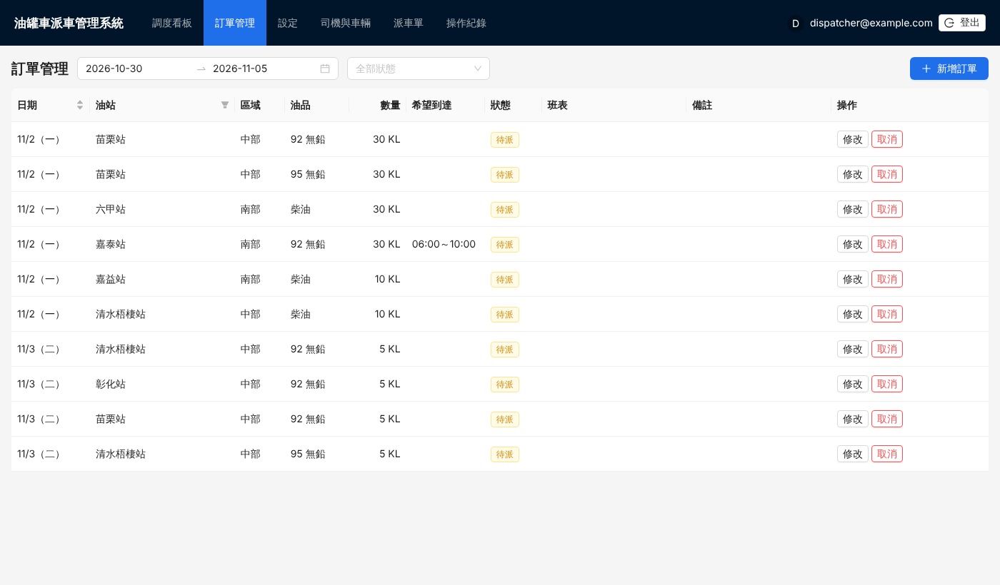

| 狀態 | 意思 |
|---|---|
| 待派 | 還沒排進任何司機的班表 |
| 已排 | 已排進班表（草稿或已發布） |
| 已完成 | 已送達，由調度員按「完成」標記 |
| 已取消 | 已取消，可以按「恢復」 |

> 已排進班表的訂單，要先從班表移出，才能修改油站、日期、油品或數量。備註和希望時段可以直接改。

在看板左上角按「新增」，也可以直接建立訂單。

---

## 3. 調度看板：把訂單拖給司機

到「調度看板」，用左上角的日期選擇要排的那一天。

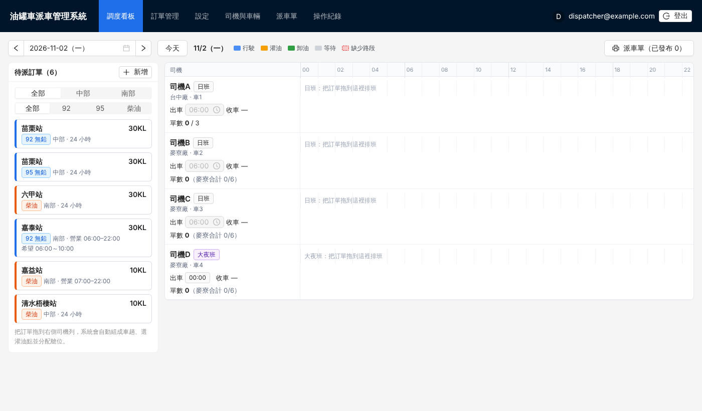

- **左側**是這一天的待派訂單，可以依區域、油品篩選。
- **右側**每位司機一列，時間從 00:00 到 24:00。

**用滑鼠把左側的訂單卡片拖到司機那一列**，系統會自動：

1. 組成車趟。同一站、同一類油品、同一個灌油點的單，會盡量併在同一趟（一趟最多送兩站）。
2. 選擇灌油點：中部到彰濱廠、南部到 R89；大夜班預設到 R89（要去彰濱廠時，在「車趟」裡手動改）。
3. 分配艙位：汽油和柴油不會放在同一趟。
4. 算出整天的時間軸與收車時間。

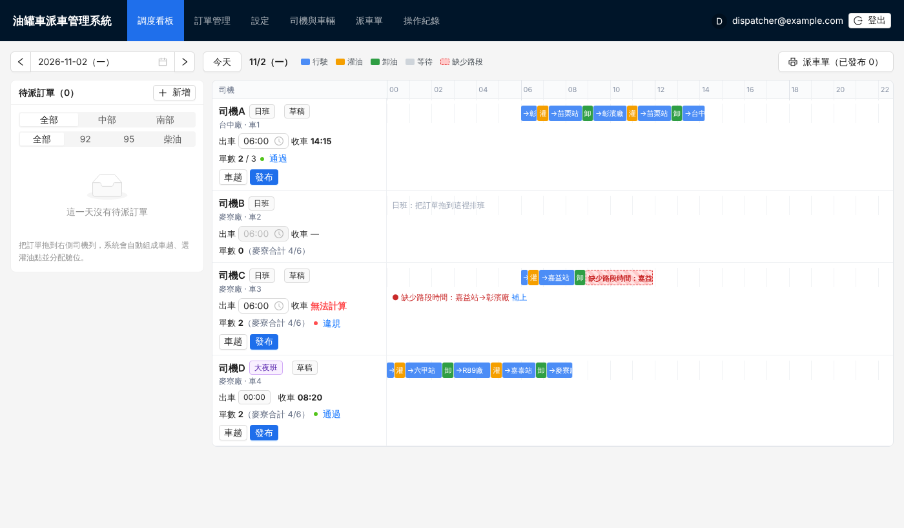

### 看懂時間軸

| 顏色 | 意思 |
|---|---|
| 藍色 | 行駛 |
| 橘色 | 灌油 |
| 綠色 | 卸油 |
| 灰色斜線 | 等待油站開門（還沒開門就到，系統自動插入等待） |
| 紅色虛線框 | 缺少路段時間，無法計算 |

把滑鼠移到色塊上，可以看到詳細時間、地點和油品數量。

### 每一列左側的資訊

- **出車**：日班可以直接改出車時間，改完立刻重算。大夜班固定 00:00 出車（要改請到設定頁）。
- **收車**：最後回到出發廠的時間。顯示「無法計算」代表有路段缺少時間。
- **單數**：以**車趟**計算，一趟送兩站算 1 單；超過 30KL 拆成兩趟算 2 單。台中廠每位司機上限 3 單；麥寮廠 3 位司機合計 6 單。
- **規則狀態**：🟢 通過、🟡 警告、🔴 違規。違規或警告的原因會直接列在時間軸下方。

點「通過／警告／違規」可以看完整的檢查結果與修正建議：

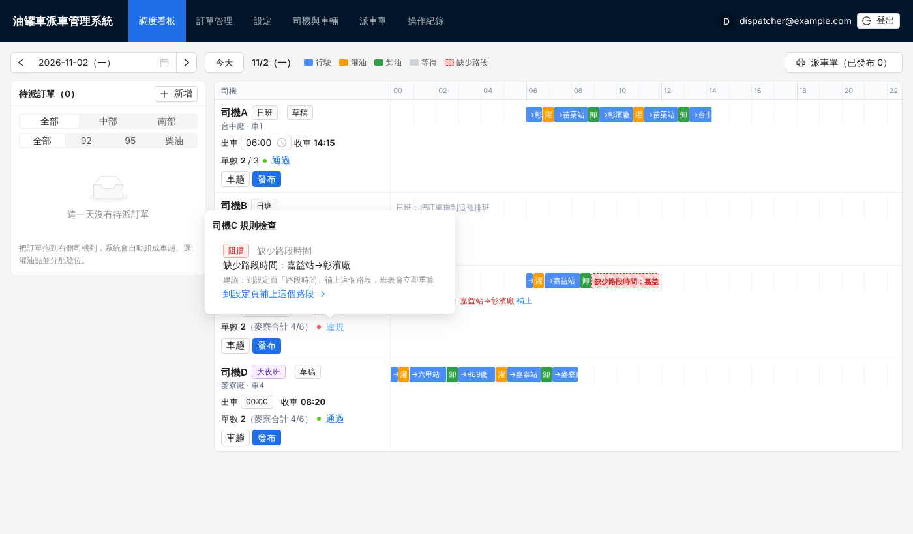

---

## 4. 調整車趟

在司機列按「車趟」，可以調整細節：

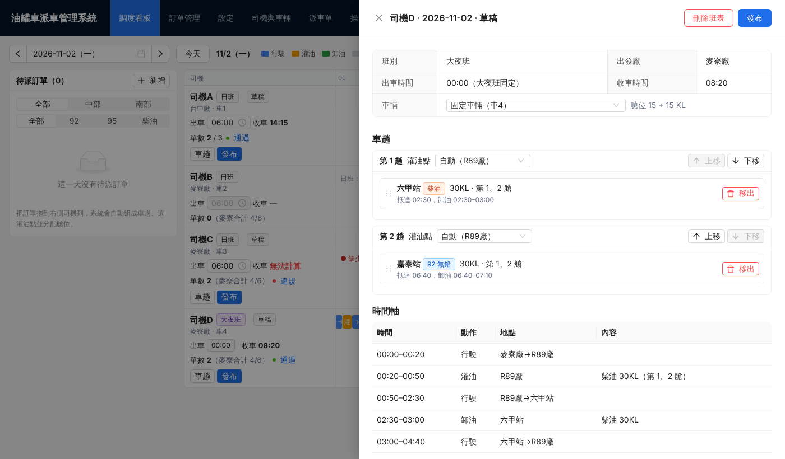

- **調整送油順序**：拖曳訂單左邊的把手 ⋮⋮。
- **調整車趟順序**：按「上移」「下移」。
- **改灌油點**：預設是「自動」；特殊情況可以手動指定。
- **換掛**：在「車輛」選其他車。只影響這一天，不會改到司機的固定車輛。
- **移出**：把訂單移出班表，它會回到左側的待派清單。
- **刪除班表**：整天的訂單都回到待派。

下方的「時間軸」表格列出每一段的時間，「規則檢查」列出所有問題。

---

## 5. 缺少路段時間時

兩個地點之間沒有行車時間資料時，系統**不會自己猜**。時間軸會顯示「缺少路段時間：A→B」，收車時間顯示「無法計算」，而且這個班表不能發布。

處理方式：

1. 點時間軸上的紅色框，或違規原因旁的「補上」，會直接打開設定頁中的那個路段。
2. 如果有 Google 地圖的小客車時間，輸入後按「套用」，系統會自動乘上油罐車倍數（1.5），並進位到 5 分。也可以直接輸入確認過的時間。
3. 按「儲存」後回到看板，系統會立即重算。

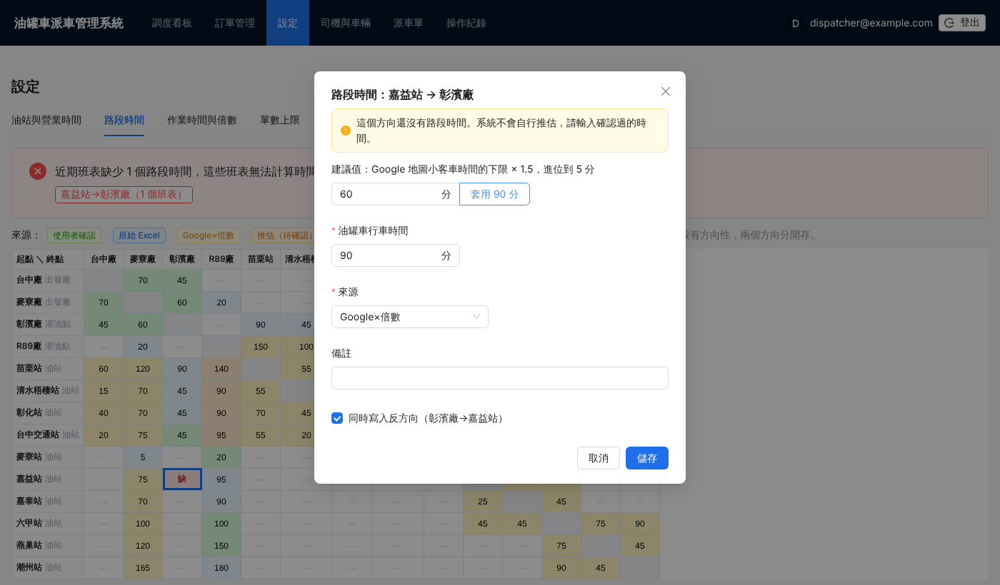

---

## 6. 發布班表

確認沒問題後，在司機列按「發布」。

- **🟢 全部通過**：直接按「確認發布」。

  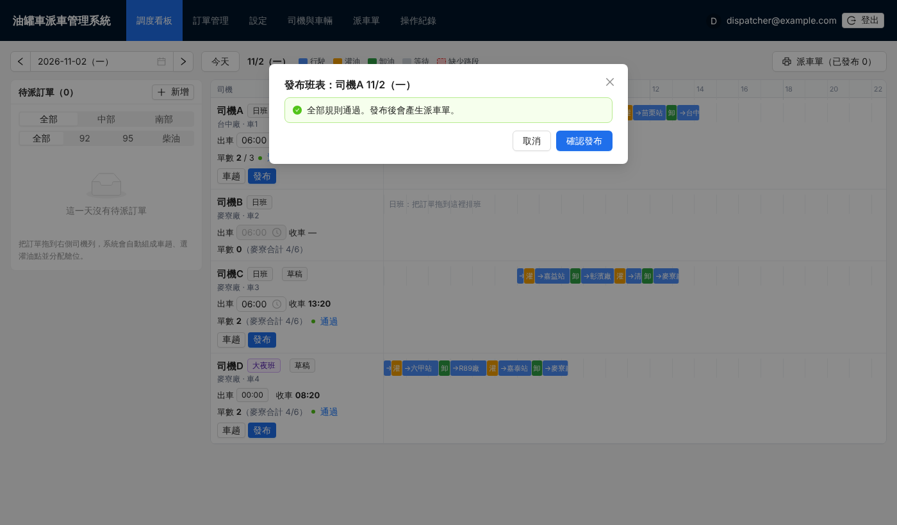

- **🟡 有警告**（例如超過單數上限）：要填寫原因才能發布。原因會記錄在操作紀錄，也會印在派車單上。

  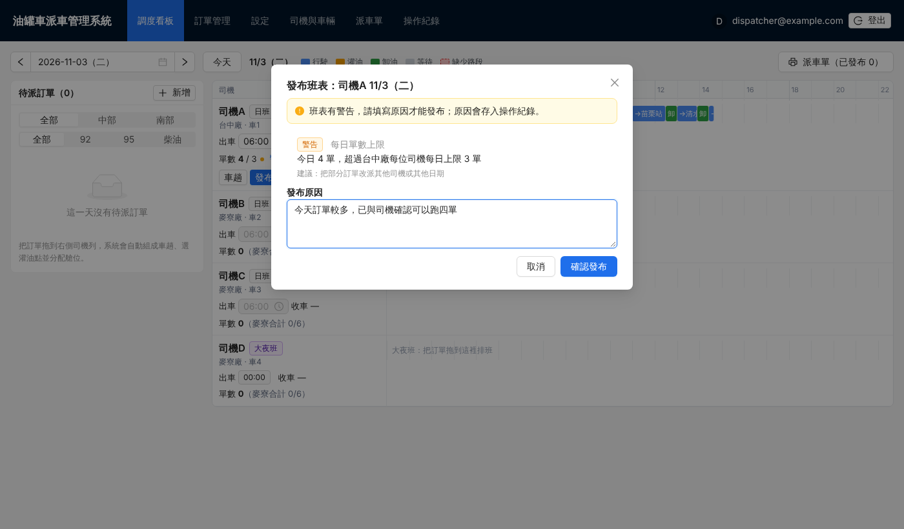

- **🔴 違規**（例如休息不足 11 小時、超過油站關門時間、缺少路段時間）：不能發布，請先依建議修正。

發布後，如果又修改了車趟、出車時間或車輛，班表會自動改回「草稿」，需要重新發布。

### 系統會檢查的規則

| 規則 | 預設 |
|---|---|
| 做六休一：連續上班最多 6 天 | 阻擋 |
| 兩天之間休息：前一天收車到隔天出車至少 11 小時（大夜班也算） | 阻擋 |
| 油站營業時間：卸油不能超過關門時間 | 阻擋 |
| 缺少路段時間 | 阻擋 |
| 每日單數上限 | 警告 |
| 每日駕車時數、連續駕車、每日工時、每月加班 | 關閉 |

規則可以在「設定 → 排班規則」開關，也可以把等級改成「阻擋」或「警告」。

---

## 7. 列印派車單

按看板右上角的「派車單」，或上方選單的「派車單」。

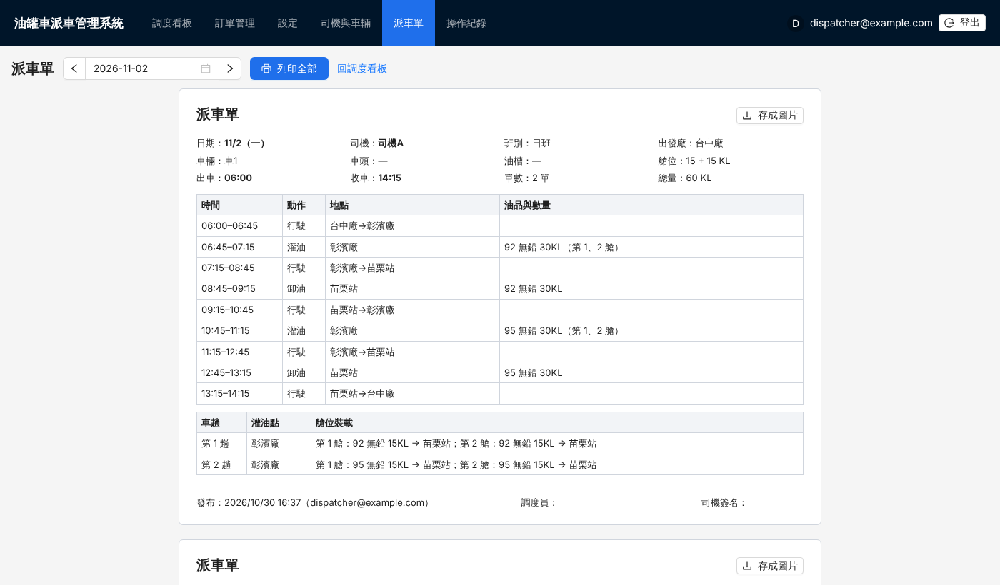

- 每位司機一張，列出出車與收車時間、每一段的時間、地點、油品數量和每艙裝載。
- **列印全部**：每張派車單印在一頁。
- **存成圖片**：把單張派車單存成 PNG，方便用 LINE 傳給司機。
- 只有「已發布」的班表會出現在這裡。還沒發布的司機，頁面上方會提醒。

---

## 8. 設定

「設定」頁的修改，存檔後看板會**立即用新的數值重算**。

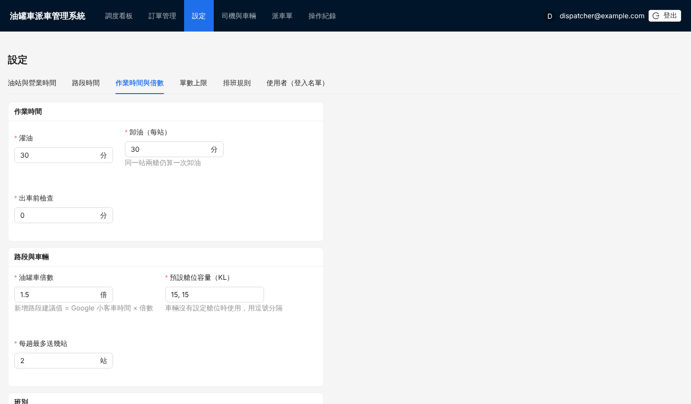

| 分頁 | 內容 |
|---|---|
| 油站與營業時間 | 24 小時或開門、關門時間；預設灌油點 |
| 路段時間 | 每兩個地點之間的行車時間（有方向性）。顏色代表資料來源，紅框代表班表需要但缺少 |
| 作業時間與倍數 | 灌油、卸油、出車前檢查的分鐘數；油罐車倍數；日班預設出車時間；大夜班出車時間與灌油點 |
| 單數上限 | 台中廠每位司機、麥寮廠合計 |
| 排班規則 | 開關、阻擋或警告、門檻數值 |
| 使用者（登入名單） | 誰可以登入（見下一節） |

「司機與車輛」頁可以修改司機姓名、所屬廠、班別、固定車輛，以及車頭、油槽車牌和艙位容量。

---

## 9. 管理可以登入的人

到「設定 → 使用者（登入名單）」：

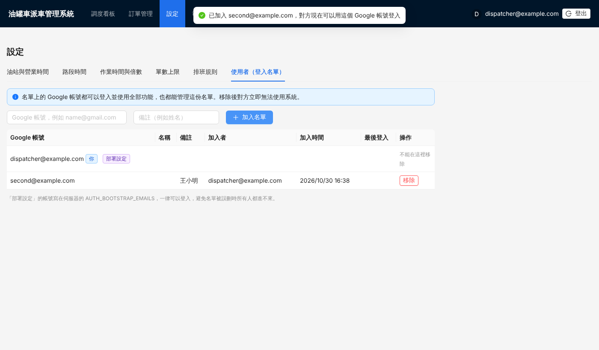

- 輸入同事的 Google 帳號（例如 `name@gmail.com`）和備註，按「加入名單」，對方就可以登入。
- 按「移除」，對方**立即**無法使用系統。
- 名單上的每個人都能管理這份名單。不能移除自己。
- 標示「部署設定」的帳號一律可以登入，系統內不能移除。

> 有人離職時，請記得把他移出名單。

---

## 10. 操作紀錄

「操作紀錄」頁記下每一筆修改：時間、操作者、內容，以及發布時填寫的警告原因。

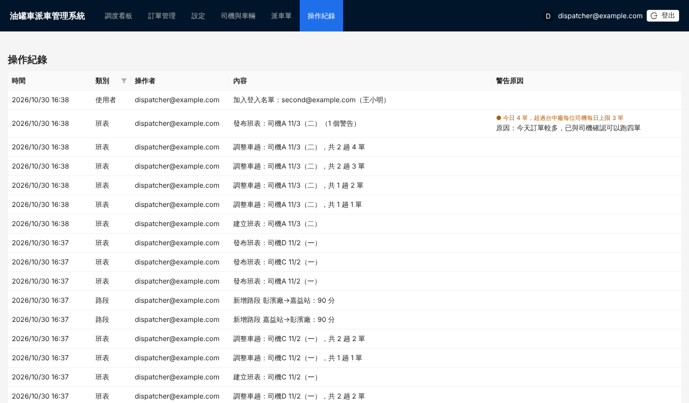

---

## 常見問題

**拖了訂單，但系統說「已取消的訂單不能排入班表」？**
到「訂單管理」按「恢復」。

**一台車想一艙裝 92、一艙裝 98（同一站或兩站）怎麼做？**
建兩張訂單（一張 92、一張 98），把兩張都拖到同一位司機。系統會自動併成同一趟、一艙一種，送兩站也可以，算 1 單。如果前面的車趟兩艙都滿了，會另開一趟；這時到「車趟」把其他單移出，再重新拖入。

**大夜班要到彰濱廠灌油？**
大夜班預設到 R89。在司機列按「車趟」，把該趟的「灌油點」改成「手動：彰濱廠」即可，時間會立刻重算。

**同一站的 92 和 95 為什麼併成一趟？**
一趟有兩艙，同一站的兩張單可以各用一艙，一次卸完。想分開送，到「車趟」把其中一張移出，再拖到別的司機。

**大夜班送台中交通站，為什麼等很久？**
台中交通站 08:00 才開門。大夜班建議排 24 小時站：清水梧棲、彰化、苗栗、六甲。

**顯示「與 11/3 出車只間隔 10 小時 35 分」？**
這是「兩天之間休息」規則，會一起檢查前一天和隔天的班表。可以提早今天的出車時間、減少車趟，或延後隔天的出車時間。

**想取消已發布班表裡的訂單？**
先在看板按「取消發布」，再到「訂單管理」取消訂單。
